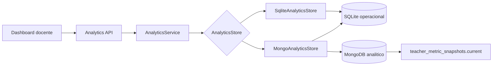
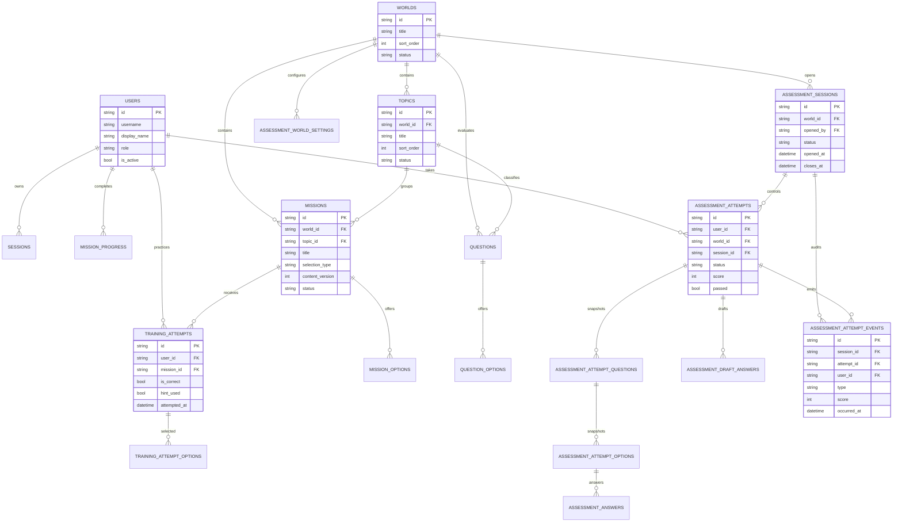
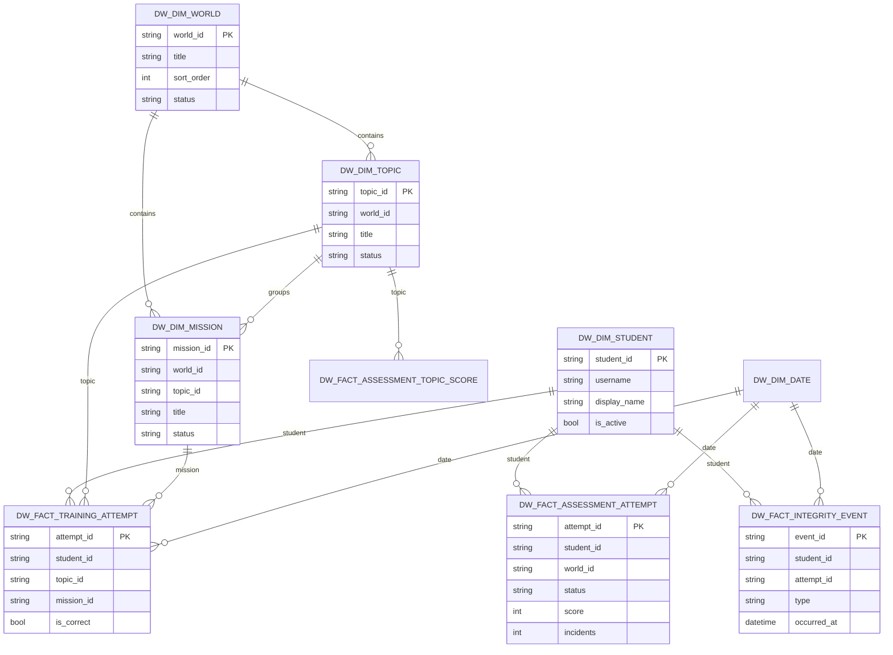
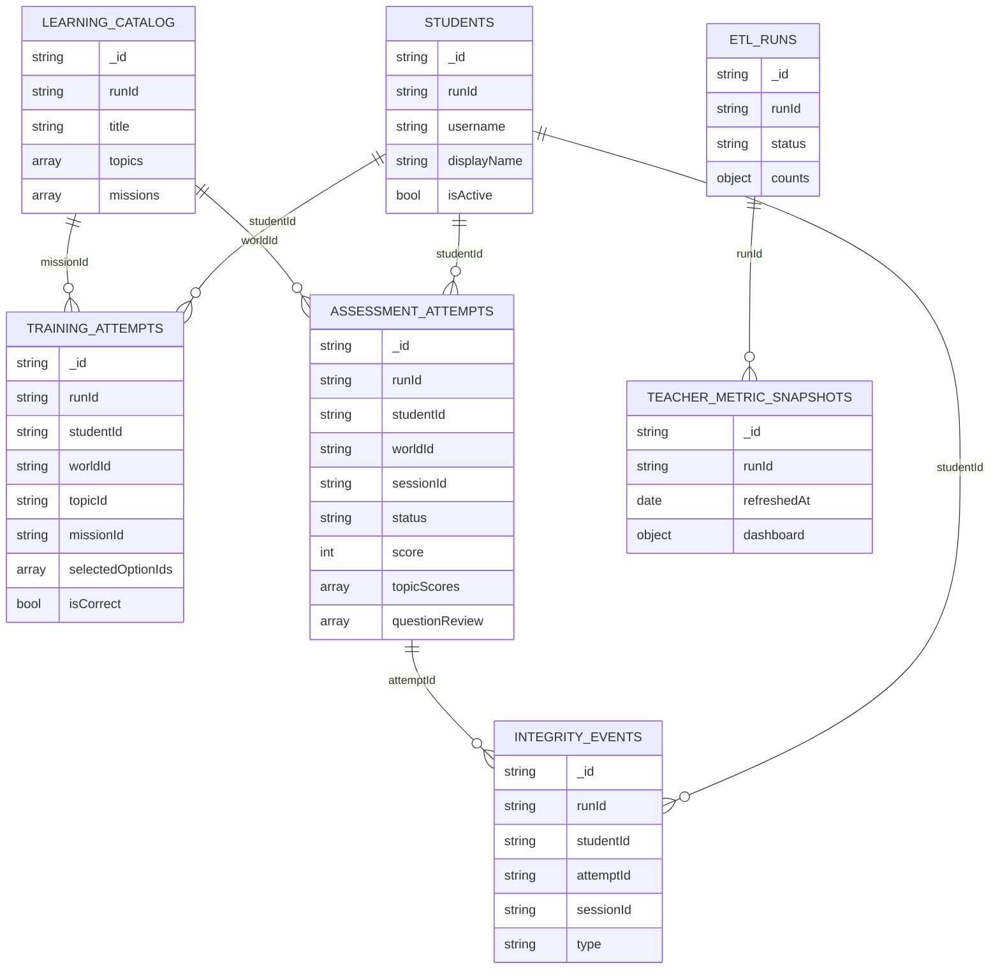

# Modelos de datos para metricas y analitica

Este documento resume el MER SQL operativo y el modelo documental MongoDB que
soporta el dashboard docente. Sirve como insumo directo para el RFC de
arquitectura.

## Decision de arquitectura

SQLite sigue siendo la fuente de verdad para autenticacion, sesiones,
entrenamiento, parciales, calificaciones, incidentes y progreso. MongoDB queda
como warehouse derivado: guarda documentos reconstruibles y snapshots del mismo
`AnalyticsDashboard` que ya consume la interfaz docente.

## MER SQL operacional

## MER SQL analitico local

## Modelo documental MongoDB

## Colecciones MongoDB

| Coleccion | Uso | Fuente |
| --- | --- | --- |
| `students` | Dimension docente de estudiantes activos/inactivos | `users` |
| `learning_catalog` | Mundo con temas y misiones embebidas | `worlds`, `topics`, `missions` |
| `training_attempts` | Hechos de entrenamiento | `training_attempts` |
| `assessment_attempts` | Intentos cerrados de parcial con revision | `assessment_attempts` y snapshots |
| `integrity_events` | Incidentes y anulaciones auditables | `assessment_attempt_events` |
| `teacher_metric_snapshots` | JSON publicado del dashboard docente | `AnalyticsDashboard` |
| `etl_runs` | Bitacora de refresh exitoso/fallido | runtime analitico |

El documento `_id = "current"` en `teacher_metric_snapshots` es el snapshot
publicado que lee `GET /api/v1/analytics/dashboard` cuando
`ANALYTICS_STORE=mongo`.
