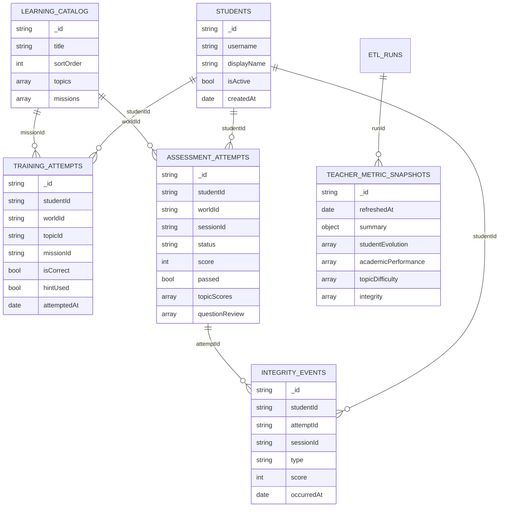

# Documento de diseno - Data warehouse MongoDB para metricas docentes

## 1. Descripcion del proyecto

Flutter Quest es una aplicacion educativa gamificada para practicar Dart y
Flutter. El estudiante avanza por mundos, temas y misiones de entrenamiento.
Al completar las misiones de un mundo, puede presentar una evaluacion final
controlada por el docente.

Usuarios:

- Docente: crea estudiantes, contenido, preguntas, sesiones de parcial y revisa
  resultados y metricas.
- Estudiante: practica en Arena de entrenamiento, presenta parciales por mundo
  y consulta su historial.

El proyecto operativo usa SQLite/API como fuente de verdad. MongoDB se plantea
como warehouse derivado para entregar metricas docentes, consultas analiticas y
respaldo documental.

## 2. Cinco consultas mas importantes

1. Ver resumen KPI docente: estudiantes, activos, precision en entrenamiento,
   promedio de parcial, aprobacion, incidentes y anulaciones.
2. Ver evolucion por estudiante: dias activos, misiones completadas, precision
   reciente, mejor nota y ultima nota.
3. Comparar rendimiento academico: promedio de parciales, aprobados, intentos
   totales y brecha entrenamiento/parcial.
4. Detectar temas criticos: precision de entrenamiento, nota de parcial por
   tema y cantidad de intentos.
5. Revisar integridad: incidentes, anulaciones, reactivaciones y nivel de
   riesgo para seguimiento docente.

Consulta adicional para sustentacion: listar sesiones de parcial por mundo con
intentos, estado, progreso, nota final e incidentes.

## 3. Justificacion de MongoDB

MongoDB es adecuado aqui porque las metricas docentes son lecturas agregadas y
documentales. El docente no necesita hacer joins complejos en vivo; necesita
ver documentos de resumen por estudiante, por tema, por intento y por sesion.

El modelo documental permite guardar snapshots del dashboard docente con la
misma forma que consume `AnalyticsDashboard`: `summary`,
`studentEvolution`, `academicPerformance`, `topicDifficulty` e `integrity`.
Eso reduce transformaciones al consultar y facilita exportar respaldo JSON.

MongoDB tambien es conveniente para eventos e intentos con estructura variable:
un intento de parcial puede tener distintos temas, preguntas, eventos,
reactivaciones e incidentes. Embedir subdocumentos de revision dentro del
intento conserva el contexto historico sin depender de joins.

Trade-off: MongoDB duplica informacion que ya existe en SQLite. Por eso debe
ser derivado y reconstruible. La calificacion, autorizacion, bloqueo de
respuestas y reglas de parciales siguen en SQLite/API.

## 4. Que seguiria mejor en SQLite/API

- Autenticacion, sesiones y cookies.
- Creacion de usuarios y claves.
- Validacion de respuestas y calificacion autoritativa.
- Apertura/cierre de sesiones de parcial.
- Anulacion estricta y reactivacion con motivo.
- Borradores de respuesta y control de deadline.

MongoDB no debe decidir notas oficiales: debe reflejarlas.

## 5. Modelo documental



## 6. Contrato de colecciones

### `students`

Dimension de estudiantes. No almacena password, hash, salt ni sesiones.

| Campo | Tipo | Regla |
| --- | --- | --- |
| `_id` | string | id de `users.id` |
| `username` | string | identificador institucional |
| `displayName` | string | nombre visible |
| `role` | string | `student` |
| `isActive` | bool | estado academico |
| `createdAt` | date | fecha de creacion |

Ejemplo:

```json
{
  "_id": "student_1",
  "username": "ana.perez",
  "displayName": "Ana Perez",
  "role": "student",
  "isActive": true,
  "createdAt": { "$date": "2026-11-15T08:00:00.000Z" }
}
```

### `learning_catalog`

Documento por mundo con temas y misiones embebidas. Sirve para filtros y
contexto del dashboard.

| Campo | Tipo | Regla |
| --- | --- | --- |
| `_id` | string | id de mundo |
| `title` | string | requerido |
| `status` | string | `draft` o `published` |
| `sortOrder` | int | orden en ruta |
| `topics` | array object | temas del mundo |
| `missions` | array object | misiones del mundo |

Ejemplo:

```json
{
  "_id": "world_1",
  "title": "Fundamentos de Dart",
  "status": "published",
  "sortOrder": 1,
  "topics": [
    { "id": "topic_types", "title": "Tipos de datos", "status": "published" }
  ],
  "missions": [
    {
      "id": "mission_variables",
      "topicId": "topic_types",
      "title": "Variables",
      "selectionType": "single",
      "contentVersion": 1,
      "status": "published"
    }
  ]
}
```

### `training_attempts`

Hecho de entrenamiento. Se mantiene separado porque crece por actividad de
estudiante y se agrega por estudiante, mundo, tema, mision y fecha.

```json
{
  "_id": "ta_001",
  "studentId": "student_1",
  "worldId": "world_1",
  "topicId": "topic_types",
  "missionId": "mission_variables",
  "selectedOptionIds": ["int"],
  "isCorrect": true,
  "hintUsed": false,
  "contentVersion": 1,
  "attemptedAt": { "$date": "2026-11-15T09:10:00.000Z" },
  "dateKey": 20261115
}
```

### `assessment_attempts`

Hecho de parcial. Embebe puntajes por tema y revision por pregunta porque el
intento es un snapshot historico de la evaluacion presentada.

```json
{
  "_id": "aa_001",
  "studentId": "student_1",
  "studentName": "Ana Perez",
  "worldId": "world_1",
  "worldTitle": "Fundamentos de Dart",
  "sessionId": "session_world_1_001",
  "status": "submitted",
  "score": 90,
  "passed": true,
  "correctAnswers": 9,
  "totalQuestions": 10,
  "incidents": 1,
  "reactivationCount": 0,
  "startedAt": { "$date": "2026-11-15T10:00:00.000Z" },
  "finishedAt": { "$date": "2026-11-15T10:18:00.000Z" },
  "topicScores": [
    {
      "topicId": "topic_types",
      "topicTitle": "Tipos de datos",
      "correctAnswers": 4,
      "totalQuestions": 5,
      "score": 80
    }
  ],
  "questionReview": [
    {
      "questionId": "q_001",
      "topicId": "topic_types",
      "wasCorrect": true,
      "selectedOptionIds": ["a"],
      "correctOptionIds": ["a"]
    }
  ]
}
```

### `integrity_events`

Hecho de integridad. Se referencia desde `attemptId` y `sessionId` porque puede
crecer durante parciales y se consulta por tipo, estudiante y fecha.

```json
{
  "_id": "ie_001",
  "studentId": "student_1",
  "studentName": "Ana Perez",
  "worldId": "world_1",
  "attemptId": "aa_001",
  "sessionId": "session_world_1_001",
  "type": "fullscreen_exit",
  "score": 1,
  "occurredAt": { "$date": "2026-11-15T10:05:00.000Z" },
  "dateKey": 20261115
}
```

### `teacher_metric_snapshots`

Snapshot listo para lectura docente. Embeber el dashboard completo es valido
porque se consulta como una unidad y se recalcula tras actividades relevantes.

```json
{
  "_id": "snapshot_20261115_101900",
  "runId": "etl_20261115_001",
  "refreshedAt": { "$date": "2026-11-15T10:19:00.000Z" },
  "summary": {
    "totalStudents": 2,
    "activeStudents": 2,
    "completedMissions": 8,
    "trainingAttempts": 15,
    "trainingAccuracy": 73,
    "averageAssessmentScore": 75,
    "approvalRate": 50,
    "incidents": 2,
    "annulledAttempts": 1
  },
  "studentEvolution": [],
  "academicPerformance": [],
  "topicDifficulty": [],
  "integrity": []
}
```

### `etl_runs`

Auditoria de cargas.

```json
{
  "_id": "etl_20261115_001",
  "source": "sqlite-export-demo",
  "status": "completed",
  "startedAt": { "$date": "2026-11-15T10:18:30.000Z" },
  "finishedAt": { "$date": "2026-11-15T10:19:00.000Z" },
  "counts": {
    "students": 2,
    "trainingAttempts": 15,
    "assessmentAttempts": 2,
    "integrityEvents": 2
  }
}
```

## 7. Decisiones de embebido y referencia

| Relacion | Decision | Justificacion |
| --- | --- | --- |
| Mundo -> temas/misiones | Embeber | El catalogo se lee como contexto del mundo y la cardinalidad es baja. |
| Estudiante -> intentos | Referenciar | Los intentos crecen con el uso; agregaciones por fecha y mundo son mas eficientes separados. |
| Intento parcial -> topicScores | Embeber | Son parte del snapshot de calificacion del intento. |
| Intento parcial -> questionReview | Embeber | Conserva evidencia historica posterior a entrega; no se usa en vivo. |
| Intento parcial -> integrity_events | Referenciar | Los eventos crecen y se consultan por tipo/riesgo/fecha. |
| Dashboard docente -> arrays de metricas | Embeber | La vista `METRICAS` se consulta como unidad despues de recalcular. |
| ETL -> snapshot | Referenciar por `runId` | Permite auditar y repetir cargas. |

## 8. Indices recomendados

- `students.username` unico.
- `learning_catalog.status + sortOrder`.
- `training_attempts.studentId + attemptedAt desc`.
- `training_attempts.worldId + topicId + attemptedAt desc`.
- `assessment_attempts.studentId + finishedAt desc`.
- `assessment_attempts.worldId + status + finishedAt desc`.
- `integrity_events.studentId + occurredAt desc`.
- `integrity_events.type + occurredAt desc`.
- `teacher_metric_snapshots.refreshedAt desc`.
- `etl_runs.startedAt desc`.

## 9. Seguridad y permisos

- Activar autenticacion en MongoDB.
- Usar usuario administrador solo para configuracion.
- Usar usuario de aplicacion con `readWrite` sobre `flutter_quest_dw`.
- No subir contrasenas al repositorio.
- No guardar password hashes ni cookies de `mision_flutter`.
- No mostrar respuestas correctas antes de una entrega oficial.

## 10. Plan de sustentacion

1. Explicar que SQLite/API es la fuente de verdad.
2. Mostrar por que MongoDB sirve como warehouse documental.
3. Mostrar colecciones, embebido/referencia e indices.
4. Ejecutar `datos_iniciales.js`.
5. Ejecutar `consultas.js`: KPI, evolucion, dificultad e integridad.
6. Ejecutar `crud_demo.js`.
7. Mostrar respaldo/export JSON.
