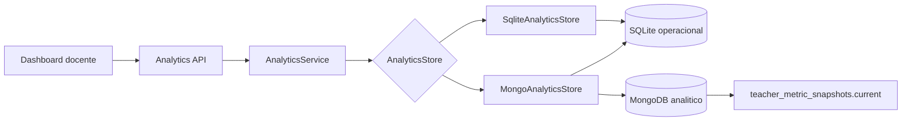
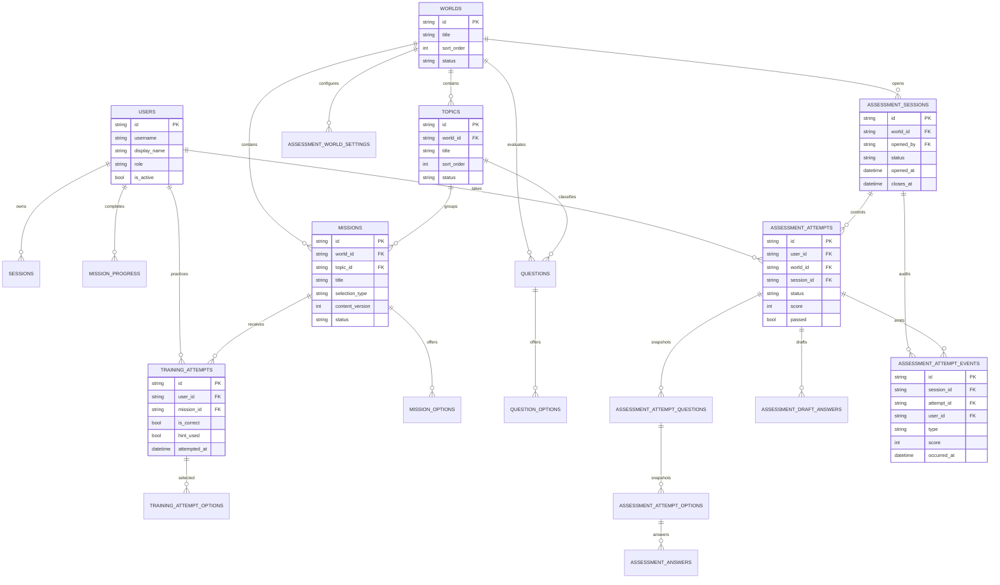
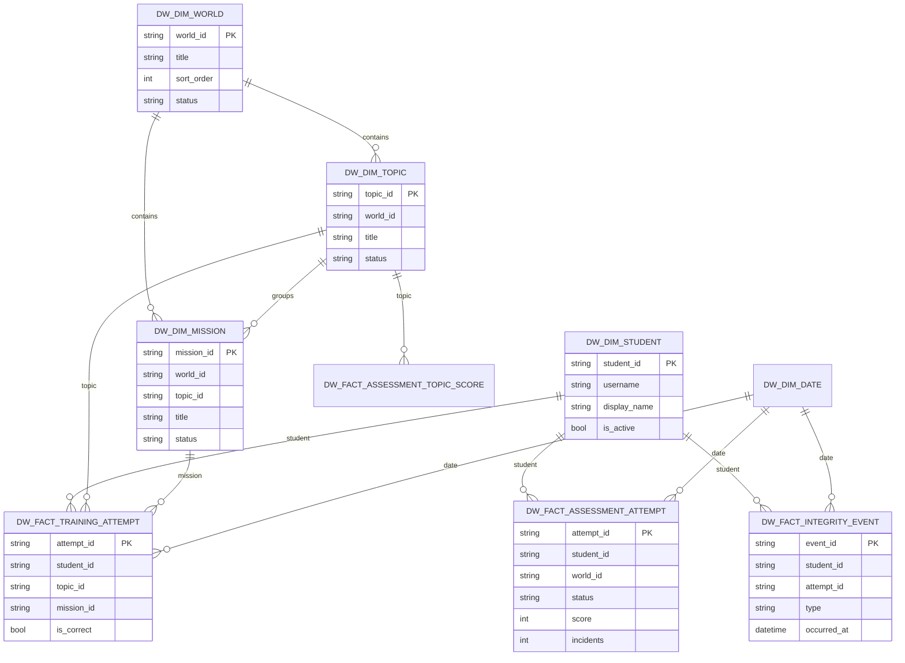
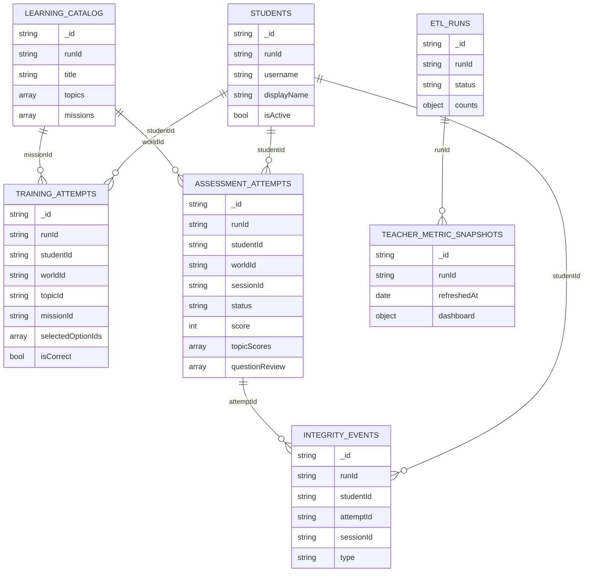
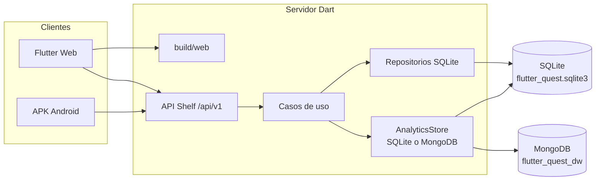
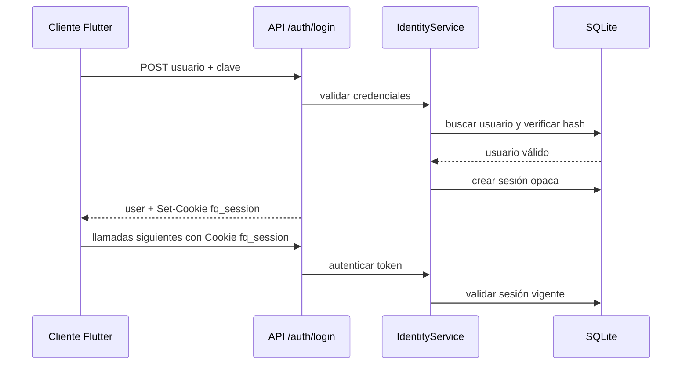
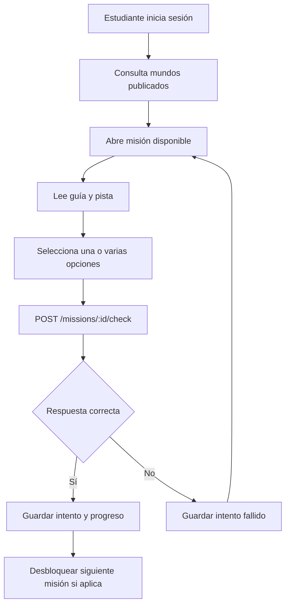
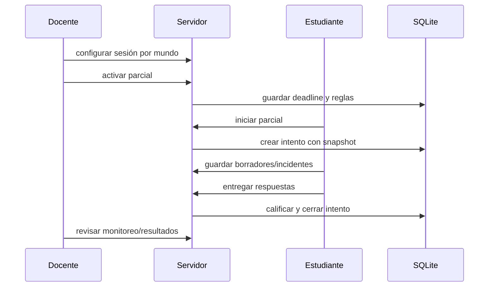

# RFC - Isekai Code Parcial

## 1. Introducción

Isekai Code Parcial, desarrollado en el repositorio `mision_flutter`, es una
aplicación educativa gamificada para practicar conceptos de Dart y Flutter por
medio de mundos, misiones de entrenamiento y parciales por mundo.

El sistema combina una interfaz Flutter, una API Dart local basada en Shelf y
una base de datos SQLite. En la versión web desplegada, el mismo proceso sirve
los archivos estáticos de Flutter Web y la API `/api/v1`. En Android, el APK
funciona como cliente HTTP y se conecta al servidor publicado mediante
`API_BASE_URL`.

Este RFC documenta la arquitectura actual, las decisiones técnicas principales,
el flujo funcional y los límites conocidos del sistema.

## 2. Motivación

El objetivo del proyecto es ofrecer una herramienta académica sencilla para que
un docente pueda:

- preparar contenido de entrenamiento por mundos, temas y misiones;
- crear preguntas evaluables para parciales;
- controlar sesiones de evaluación por mundo;
- revisar resultados, incidentes y métricas;
- permitir que estudiantes practiquen y presenten parciales con historial.

La decisión de usar un monolito Dart local con SQLite reduce la complejidad
operativa para un contexto académico: no exige PostgreSQL, Redis ni servicios
externos para funcionar. El trade-off es claro: simplifica despliegue y
mantenimiento, pero no está diseñado como backend multiinstancia ni como
plataforma de alta concurrencia.

## 3. Situación Actual

### Producto

La aplicación incluye dos roles:

- `teacher`: administra estudiantes, contenido, preguntas, parciales, informes
  y métricas.
- `student`: practica en la Arena de entrenamiento, desbloquea mundos y
  presenta parciales en la Cámara del jefe final.

El catálogo inicial incluye dos mundos, nueve temas y nueve misiones. El
docente puede crear y publicar contenido adicional desde la interfaz.

### Capacidades Implementadas

- Bootstrap del docente inicial.
- Creación de cuentas estudiantiles.
- Login con sesiones opacas.
- Claves protegidas con hash Argon2id.
- Catálogo persistido en SQLite.
- Misiones con guía, pista, plantilla de código y opciones.
- Selección única y múltiple en entrenamiento.
- Progreso secuencial por estudiante.
- Banco versionado de preguntas.
- Parciales por mundo con snapshots de contenido.
- Sesiones de parcial activadas por docente.
- Temporizador sincronizado por sesión.
- Registro de incidentes y anulación estricta configurable.
- Reactivación docente con motivo.
- Informes filtrables por estudiante, mundo y tema.
- Métricas docentes derivadas en SQLite.
- Despliegue web/API con Docker y Cloudflare Tunnel.
- APK Android cliente HTTP apuntando a dominio público mediante
  `--dart-define=API_BASE_URL=...`.

### Capacidades No Implementadas O Limitadas

- Android no tiene adaptador SQLite nativo offline.
- No hay recuperación/cambio de clave desde la UI.
- No hay eliminación/importación/exportación completa de contenido.
- No hay arquitectura multiinstancia con base externa.
- MongoDB no es fuente operativa: funciona como warehouse derivado opcional
  para métricas docentes.
- Pantalla completa y bloqueo de teclas en parciales son controles best effort;
  la autoridad real está en eventos persistidos y reglas del servidor.

## 4. Modelo De Datos Para Métricas Y Analítica

El modelo de analítica mantiene una separación deliberada: SQLite conserva los
datos operativos y MongoDB actúa como almacén derivado para lecturas docentes.
Esto evita mover reglas críticas de autenticación, calificación, sesiones,
incidentes y progreso fuera de la base autoritativa.



### MER SQL Operacional

Este MER resume las entidades transaccionales principales. Aquí viven usuarios,
catálogo, entrenamiento, parciales, sesiones, respuestas e incidentes. Es el
modelo que conserva la autoridad académica.



### MER SQL Analítico Local

El data warehouse local en SQLite materializa dimensiones y hechos derivados.
Su valor está en consultas agregadas rápidas y reconstruibles; no reemplaza las
tablas operativas.



### Modelo Documental MongoDB

MongoDB guarda documentos derivados y snapshots listos para lectura. El
documento `_id = "current"` en `teacher_metric_snapshots` representa el
dashboard publicado que lee `GET /api/v1/analytics/dashboard` cuando
`ANALYTICS_STORE=mongo`.



| Colección | Uso | Fuente |
| --- | --- | --- |
| `students` | Dimensión docente de estudiantes activos/inactivos. | `users` |
| `learning_catalog` | Mundo con temas y misiones embebidas. | `worlds`, `topics`, `missions` |
| `training_attempts` | Hechos de entrenamiento. | `training_attempts` |
| `assessment_attempts` | Intentos cerrados de parcial con revisión. | `assessment_attempts` y snapshots |
| `integrity_events` | Incidentes y anulaciones auditables. | `assessment_attempt_events` |
| `teacher_metric_snapshots` | JSON publicado del dashboard docente. | `AnalyticsDashboard` |
| `etl_runs` | Bitácora de refresh exitoso/fallido. | runtime analítico |

## 5. Propuesta Arquitectónica

La arquitectura actual se mantiene como monolito modular:



### Capas

| Capa | Responsabilidad |
| --- | --- |
| `lib/features` | Vistas Flutter para estudiante y docente. |
| `lib/core/store` | Estado reactivo de sesión, juego, autoría, parciales y métricas. |
| `lib/core/models` | Modelos serializables y contratos de datos. |
| `lib/core/repositories` | Puertos de acceso y adaptador HTTP. |
| `lib/application` | Casos de uso y reglas de autorización por rol. |
| `lib/server/api` | Endpoints Shelf, seguridad y serialización HTTP. |
| `lib/server/repositories` | Persistencia SQLite y snapshots MongoDB derivados para analítica. |
| `lib/server/database` | Migraciones, semilla inicial y esquema. |
| `bin/server.dart` | Proceso que une API, SQLite y archivos web. |

### Decisiones Técnicas

| Decisión | Razón | Trade-off |
| --- | --- | --- |
| Flutter para UI | Un solo stack visual web/móvil. | Android depende del backend HTTP actual. |
| Shelf como servidor Dart | Suficiente para API local y entrega web. | Menos ecosistema empresarial que frameworks backend mayores. |
| SQLite como fuente de verdad | Simple, portable y adecuado para despliegue académico. | No es ideal para múltiples instancias concurrentes. |
| Sesiones opacas con cookie | Evita exponer datos de sesión al cliente web. | En APK se requiere manejo explícito de cookie en el cliente HTTP. |
| Docker + Cloudflare Tunnel | Publicación simple sin abrir puertos públicos directos. | El servidor queda atado a un host/volumen local. |
| `dart build cli` | Compatible con build hooks de `sqlite3`. | Requiere copiar el bundle completo al runtime. |

## 6. Estrategia De Implementación

### Desarrollo Local

```sh
flutter pub get
flutter build web
dart run bin/server.dart
```

El servidor local escucha por defecto en:

```text
http://127.0.0.1:8080
```

La base local se crea en:

```text
data/flutter_quest.sqlite3
```

### Despliegue Web/API

El despliegue productivo recomendado usa Docker:

```sh
docker-compose -f compose.prod.yaml build --no-cache
docker-compose -f compose.prod.yaml up -d
```

El contenedor escucha internamente en `8080`, pero el host solo publica:

```text
127.0.0.1:18081
```

Cloudflare Tunnel debe apuntar a:

```text
http://localhost:18081
```

### APK Android

El APK se compila como cliente HTTP del servidor publicado:

```sh
flutter build apk --release \
  --dart-define=API_BASE_URL=https://isekai-code-lerning.kvf-enginner.com/api/v1/
```

Si cambia el dominio público o la ruta base de la API, se debe recompilar el
APK. El valor de `API_BASE_URL` queda embebido en build time.

## 7. Flujos Funcionales

### Login Y Sesión



En navegador, la cookie la conserva el browser. En APK, el adaptador HTTP
captura `Set-Cookie` y reenvía `Cookie` manualmente.

### Entrenamiento



### Parcial Controlado



La anulación automática se basa en eventos persistidos y configuración de la
sesión. El docente puede reactivar un intento con motivo, dejando trazabilidad.

## 8. Referencias Y Alcance

### Archivos Principales

- `README.md`: ejecución local, despliegue Android y enlaces operativos.
- `docs/despliegue-docker-cloudflare.md`: despliegue Ubuntu/Docker/Cloudflare.
- `docs/despliegue-analytics-docker.md`: despliegue SQLite o SQLite + MongoDB
  analítico.
- `docs/architecture/analytics-data-models.md`: MER SQL y modelo documental
  MongoDB para métricas.
- `docs/instructivo-docente.md`: uso funcional del panel docente.
- `docs/stories-users.md`: historias y reglas académicas de base.
- `.specs/context.md`: estado acumulado de features implementadas.
- `bin/server.dart`: composición del servidor.
- `lib/main.dart`: entrada Flutter y resolución de `API_BASE_URL`.
- `lib/server/database/catalog_database.dart`: esquema SQLite y migraciones.
- `lib/core/repositories/http_catalog_repository.dart`: cliente HTTP.
- `Dockerfile` y `compose.prod.yaml`: empaquetado y ejecución en servidor.

### Alcance Del RFC

Este RFC describe la arquitectura implementada y la forma actual de operación.
No reemplaza el instructivo docente ni la guía de despliegue paso a paso.

### Fuera De Alcance

- Migración a PostgreSQL o backend multiusuario cloud.
- App Android completamente offline.
- Publicación en Play Store con firma productiva.
- MongoDB como fuente autoritativa de notas, sesiones o autenticación.
- Integración con LMS, correo institucional o SSO.

## 9. Próximos Pasos

Prioridad recomendada:

1. Definir estrategia de backup y restauración del volumen SQLite en servidor.
2. Agregar cambio/restablecimiento de clave para usuarios.
3. Incorporar exportación de resultados en CSV/PDF.
4. Agregar configuración externa para dominio/API sin recompilar APK.
5. Evaluar si Android debe seguir como cliente HTTP o migrar a modo offline.
6. Endurecer seguridad de despliegue: headers, monitoreo, logs y rotación de
   respaldos.
7. Si aumenta la concurrencia, evaluar migración de SQLite a PostgreSQL antes
   de escalar instancias.

## 10. Anexos

### Endpoints Representativos

| Método | Ruta | Uso |
| --- | --- | --- |
| `GET` | `/api/v1/health` | Salud de API/base. |
| `GET` | `/api/v1/auth/status` | Estado de sesión/bootstrap. |
| `POST` | `/api/v1/auth/bootstrap` | Crear docente inicial. |
| `POST` | `/api/v1/auth/login` | Iniciar sesión. |
| `POST` | `/api/v1/users` | Crear estudiante. |
| `GET` | `/api/v1/worlds` | Listar mundos publicados. |
| `POST` | `/api/v1/missions/:id/check` | Calificar entrenamiento. |
| `GET` | `/api/v1/assessments` | Estado de parciales del estudiante. |
| `POST` | `/api/v1/assessment-sessions` | Activar parcial por mundo. |
| `GET` | `/api/v1/reports` | Informes docentes. |
| `GET` | `/api/v1/analytics/dashboard` | Métricas docentes. |

### Variables Y Puertos

| Elemento | Valor actual |
| --- | --- |
| Puerto interno contenedor | `8080` |
| Puerto host recomendado | `127.0.0.1:18081` |
| Cloudflare Service URL | `http://localhost:18081` |
| Dominio público usado por APK | `https://isekai-code-lerning.kvf-enginner.com/api/v1/` |
| SQLite en Docker | `/app/data/flutter_quest.sqlite3` |
| Volumen Docker | `flutter_quest_data` |
| Flutter en Docker | `3.47.9` |
| Dart requerido | `^3.13.0` |

### Riesgos Técnicos

| Riesgo | Impacto | Mitigación |
| --- | --- | --- |
| Pérdida del volumen SQLite | Pérdida de usuarios, progreso y notas. | Backups periódicos y prueba de restauración. |
| Cambio de dominio API | APK deja de conectarse. | Recompilar con nuevo `API_BASE_URL` o diseñar configuración remota. |
| Concurrencia alta | Bloqueos o lentitud en SQLite. | Medir carga y migrar a PostgreSQL si el uso crece. |
| Tunnel mal apuntado | Web/API inaccesibles. | Validar `curl http://127.0.0.1:18081/api/v1/health`. |
| Sesión en APK no persistida tras cerrar app | Re-login frecuente. | Persistir token/cookie de forma segura si se requiere sesión durable. |

